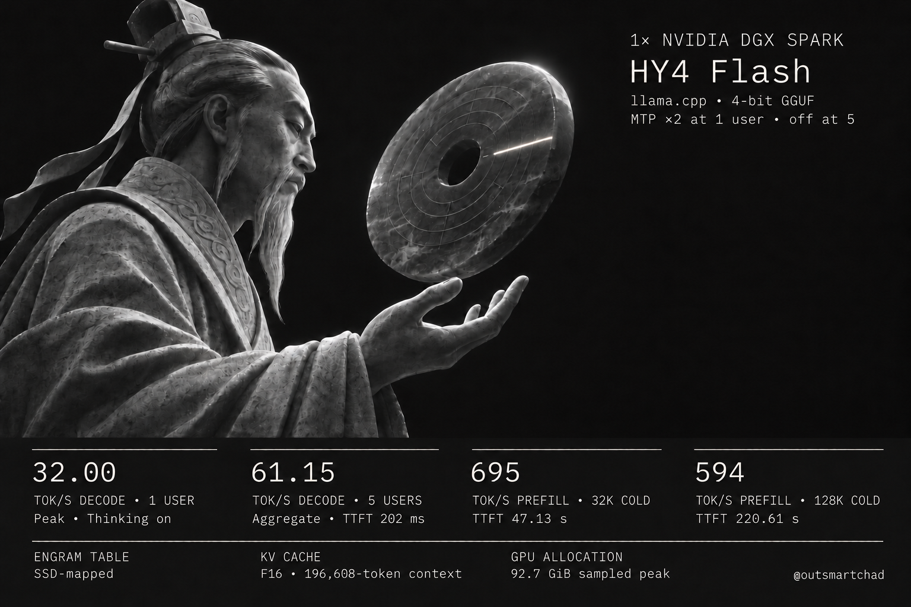

# HY4 Flash on one DGX Spark



Tencent's HY4 Flash, served with AngelSlim's Spark CUDA patch for llama.cpp and the Spark-4Bit-Fast GGUF. The **148.65 GiB** checkpoint fits this deployment because the largest table is memory-mapped from SSD. The patched engine reads selected Engram rows on the CPU and runs the main model on the GB10. [Model architecture](docs/how-it-works.md)

## Run it

Use one DGX Spark with CUDA 13.0 and working `nvcc`. Leave at least 160 GB of SSD space for the Fast checkpoint plus room for the build. Run these commands on the Spark.

```bash
git clone https://github.com/outsmartchad/hy4-flash-single-dgx-spark-llamacpp.git
cd hy4-flash-single-dgx-spark-llamacpp
./bin/recipe.sh doctor
./bin/recipe.sh build fast
./bin/recipe.sh fetch fast
./bin/recipe.sh serve fast
```

From a second Spark terminal:

```bash
curl -fsS http://127.0.0.1:18911/v1/chat/completions \
  -H 'Content-Type: application/json' \
  -d '{"model":"hy4-flash","messages":[{"role":"user","content":"Reply with exactly HY4_OK and nothing else."}],"max_tokens":32,"reasoning_effort":"no_think","chat_template_kwargs":{"enable_thinking":false}}'
```

The download resumes partial transfers and checks SHA-256. The launcher uses a pinned llama.cpp revision and a verified patch. It serves one slot on `127.0.0.1:18911`, with a 196,608-token context and F16 KV cache. [Setup and benchmark commands](docs/reproduce.md) · [Troubleshooting](docs/troubleshooting.md)

## Measurements

The current one-user default is **MTP ×2**. On November 23, it reached **32.00 tok/s peak**, **30.96 tok/s median** and **135 ms median TTFT** in the six-request qualification replay. The candidate improved median decode by 10.4–10.8% against its adjacent MTP ×3 controls. For five users, the fastest observed result remained **MTP off**. [Tuning report and raw data](docs/tuning-2026-11-23.md)

### Initial one-user sweep

Measured on November 22, 2026 on an ARM64 DGX Spark with Ubuntu 24.04.5 LTS, NVIDIA driver 580.178.04 and CUDA 13.0.88. Requests went directly to the Spark's loopback API. The comparison uses a single session, a thinking-on prose prompt and six measured requests per profile. Only speculative decoding changes between profiles.

| Profile | Median decode | Fastest request | Median TTFT |
| --- | ---: | ---: | ---: |
| MTP ×3, control A | 27.77 tok/s | 29.66 tok/s | 135 ms |
| MTP off | 25.78 tok/s | 26.00 tok/s | 131 ms |
| MTP ×3, control B | 28.08 tok/s | 29.62 tok/s | 138 ms |
| MTP ×5 | 22.00 tok/s | 23.49 tok/s | 136 ms |
| MTP ×3, control C | 27.31 tok/s | 28.65 tok/s | 135 ms |
| **MTP ×3, final** | 28.12 tok/s | 30.49 tok/s | 135 ms |

The final MTP ×3 run had a 9% higher median decode rate than MTP off. MTP ×5 accepted 26% of draft proposals. The final ×3 run accepted 41%. This sweep selected ×3 for the initial recipe. [Benchmark method and selection rule](docs/method.md) · [Raw results](results/)

### Five concurrent users

The November 23 short-prose replay used five serving slots, the same Fast GGUF and F16 KV cache, and 196,608 configured context tokens shared by the server. Every wave ran five simultaneous thinking-on requests with 400 output tokens apiece.

| Profile | Median aggregate | Fastest aggregate | Median TTFT in fastest wave |
| --- | ---: | ---: | ---: |
| [MTP ×3](results/c5-mtp3.json) | 54.22 tok/s | 56.09 tok/s | 707 ms |
| [MTP ×1](results/c5-mtp1.json) | 57.81 tok/s | 59.21 tok/s | 211 ms |
| **[MTP off](results/c5-off.json)** | **60.29 tok/s** | **61.15 tok/s** | **202 ms** |

MTP off had the highest observed throughput in this five-slot test. All five streams decoded together for over 27 seconds in every wave. The card's cold-prefill and GPU-memory figures come from the separate one-slot run. Five simultaneous full-context prompts were outside this measurement.

### Cold prefill

| Actual input tokens | Engine prefill | Client prefill | TTFT | Exact retrieval |
| ---: | ---: | ---: | ---: | :--- |
| 32,762 | 695.7 tok/s | 695.1 tok/s | 47.13 s | Passed |
| 131,073 | 594.9 tok/s | 594.1 tok/s | 220.61 s | Passed |

Both MTP ×2 requests had zero cached prompt tokens. Client rate includes time to first streamed token. [MTP ×2 timings](results/tuning-20261123/qualification-prefill.json) · [Original MTP ×3 timings](results/final-prefill.json)

### Memory and smoke checks

The MTP ×2 qualification server reached **92.7 GiB sampled GPU-process allocation**. The lowest system `MemAvailable` was **22.3 GiB** during startup and the timed requests. The driver and Linux measure different aspects of the same unified memory pool. [Memory samples](results/tuning-20261123/qualification.memory.csv)

The MTP ×2 run passed basic chat, separate reasoning, exact Traditional Chinese copying, and a synthetic tool-call round trip. The validation covers text and one active session. [MTP ×2 checks](results/tuning-20261123/qualification-checks.json) · [Original MTP ×3 checks](results/checks.json)

## Files

- [How HY4 Flash works and runs on one Spark](docs/how-it-works.md)
- [Spark install, localhost API and reproduction](docs/reproduce.md)
- [Benchmark method](docs/method.md) and [raw results](results/)
- [Memory-bandwidth and arithmetic estimates](docs/performance-bounds.md)
- [Troubleshooting](docs/troubleshooting.md)

The scripts and documentation in this repository use the [MIT license](LICENSE). Tencent and AngelSlim distribute the model and Spark artifacts under their respective upstream terms. [Tencent model license](https://huggingface.co/tencent/Hy4-flash/blob/b2498eba6a1a3f9bbcab4190bc1313a3c7010c2f/LICENSE) · [AngelSlim weights and patch](https://huggingface.co/AngelSlim/Hy4-flash-GGUF/tree/bcbc7db5dcf4162cc1e1b8ed6c65567e843ebe46)
